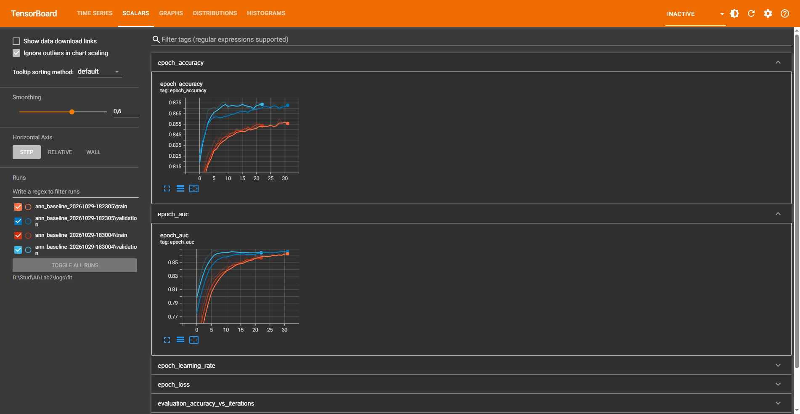

# Лабораторная работа №2: Классификация данных и нейронные сети (TensorFlow / TensorBoard)

Проект по дисциплине «Искусственный интеллект» / «Машинное обучение».  
Тема: **Прогнозирование оттока клиентов финансовой организации (Bank Customer Churn) с использованием ансамбля классификаторов Scikit-Learn и глубокой нейронной сети в TensorFlow с мониторингом в TensorBoard.**

---

## 📁 Структура проекта

```
AI_Lab_2/
│
├── Lab2.ipynb                     # 📓 Основной отчет и выполненная лабораторная работа (с графиками, таблицами и подробными выводами)
├── Churn_Modelling.csv            # 📊 Исходный датасет с Kaggle (10 000 строк) в корне для прямого запуска ноутбука
│
├── data/                          # 📂 Резервная копия исходных данных
│   └── Churn_Modelling.csv        # Оригинальный файл датасета с Kaggle
│
├── info/                          # 📋 Методические материалы
│   ├── task.docx                  # Официальное задание в формате Word
│   └── task.md                    # Структурированное техническое задание в формате Markdown
│
├── logs/                          # 📈 Логи TensorBoard
│   └── fit/                       # Градиентные события и метрики по эпохам (loss, accuracy, auc)
│
└── defense/                       # 🎓 Материалы для подготовки к защите (3 раздела)
    │
    ├── 01_code/                   # 💻 Блок 1: Защита по коду
    │   ├── Lab2_clean.ipynb       # Чистый блокнот без текстовых выводов (для проверки преподавателем)
    │   ├── lab2_code.py           # Чистый исполняемый скрипт без комментариев
    │   └── Lab2_Def_Answers.md    # Подробная шпаргалка с ответами на 13 ключевых вопросов по коду
    │
    ├── 02_theory/                 # 📚 Блок 2: Защита по теории
    │   └── Lab_2_Def_Theory.md    # Шпаргалка по математической теории всех 5 методов, нейросетям и метрикам
    │
    └── 03_practice/               # ✍️ Блок 3: Защита по практическим задачам
        └── Lab_2_Def_Prac.md      # Решения 5 типовых задач (Confusion Matrix, Gini, Bayes, k-NN, пороги)
```

---

## 📊 Итоговые результаты сравнительного анализа моделей

Все модели исследованы на тестовой выборке ($2\\,000$ наблюдений со стратификацией):

| Метод классификации | Библиотека | Accuracy | Precision | Recall | F1-Score | ROC-AUC | Ключевая особенность |
| :--- | :---: | :---: | :---: | :---: | :---: | :---: | :--- |
| **Neural Network (MLP)** | **TensorFlow** | **0.8640** | 0.7509 | 0.4963 | **0.5976** | **0.8594** | 🥇 **Абсолютный лидер** по AUC, F1 и Accuracy |
| **Decision Tree (Tuned)**| Scikit-Learn | 0.8565 | 0.6974 | **0.5209** | 0.5963 | 0.8401 | 🥈 **Максимальный Recall** (находит 52.1% оттока) |
| **SVM (RBF Tuned)** | Scikit-Learn | 0.8605 | **0.8168** | 0.4054 | 0.5419 | 0.8268 | 🥉 **Рекордный Precision** (минимум ложных тревог) |
| **Naive Bayes (Gaussian)**| Scikit-Learn | 0.8200 | 0.6000 | 0.3464 | 0.4393 | 0.7843 | Лучший среди байесовских подвидов |
| **k-NN (Tuned)** | Scikit-Learn | 0.8260 | 0.6266 | 0.3587 | 0.4562 | 0.7600 | Метрический оптимум при $k=5$, weights='distance' |
| **LDA** | Scikit-Learn | 0.8030 | 0.5419 | 0.2064 | 0.2989 | 0.7752 | Линейная разделяющая гиперплоскость |

---

## 🚀 Мониторинг в TensorBoard

В коде настроен коллбэк `TensorBoard`, протоколирующий динамику функции потерь и метрик обучения:
1. Логи обучения сохранены в директорию: `logs/fit/ann_baseline_20261029-183004` (а также предыдущий запуск).
2. Запустите сервер визуализации в терминале:
   ```bash
   tensorboard --logdir logs/fit
   ```
3. Перейдите в браузере по адресу: [http://localhost:6006](http://localhost:6006).

### Скриншот панели TensorBoard (Scalars: Accuracy и AUC)


---

## 🎓 Быстрый старт перед защитой

1. **Показать преподавателю готовый рабочий отчет с графиками и выводами:**
   - Откройте **[`Lab2.ipynb`](file:///D:/Stud/AI/Lab2/Lab2.ipynb)** в VS Code или Jupyter Notebook (выберите ядро `Python 3.11 (ML & TF)`).
2. **Если преподаватель просит показать чистый код:**
   - Откройте **[`defense/01_code/Lab2_clean.ipynb`](file:///D:/Stud/AI/Lab2/defense/01_code/Lab2_clean.ipynb)** или скрипт **[`defense/01_code/lab2_code.py`](file:///D:/Stud/AI/Lab2/defense/01_code/lab2_code.py)**.
3. **Шпаргалка при вопросах по коду:**
   - Откройте **[`defense/01_code/Lab2_Def_Answers.md`](file:///D:/Stud/AI/Lab2/defense/01_code/Lab2_Def_Answers.md)**.
4. **Шпаргалка по формулам и теории:**
   - Откройте **[`defense/02_theory/Lab_2_Def_Theory.md`](file:///D:/Stud/AI/Lab2/defense/02_theory/Lab_2_Def_Theory.md)**.
5. **Шпаргалка по типовым практическим задачам преподавателя:**
   - Откройте **[`defense/03_practice/Lab_2_Def_Prac.md`](file:///D:/Stud/AI/Lab2/defense/03_practice/Lab_2_Def_Prac.md)**.

---

### 🔗 Ссылка на датасет:
* Платформа: **Kaggle**
* Название: **[Bank Customer Churn Prediction (Churn Modelling)](https://www.kaggle.com/datasets/shrutimechlearn/churn-modelling)**
